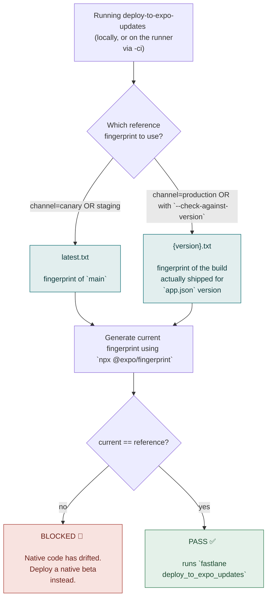
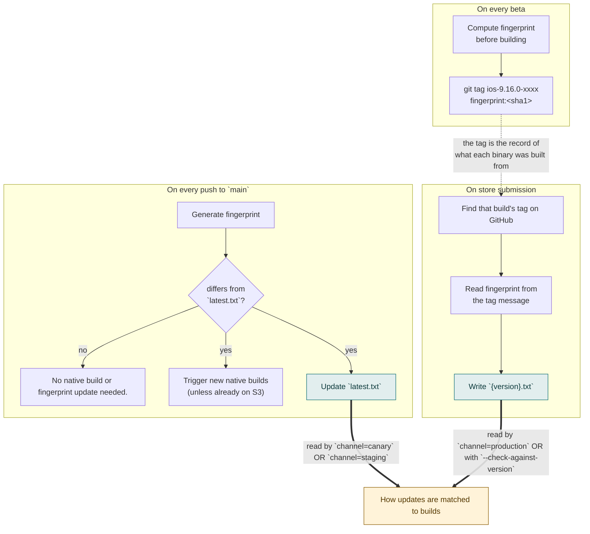

## Deploying to Expo Updates

In order to allow faster testing for typescript changes on real devices you can deploy your changes to [expo updates](https://docs.expo.dev/versions/latest/sdk/updates/).

### Prerequisites

You will need to have the latest beta downloaded from firebase in order to run expo updates. If you need help getting access please ask in the **#practice-mobile** channel.

You will need the release environment vars and the cli tools in the bin directory. Both are needed either way, since the pre-flight fingerprint check below runs locally even when you publish via CI:

```
yarn setup:releases
./scripts/setup/install-bin
```

### Deploying (default: publishes via GitHub Actions)

Make your changes in typescript, commit and push your changes, then run:

```
./scripts/deploys/expo-updates/deploy-to-expo-updates-ci <deployment> [description] [rollout_percentage] [--platform ios|android|all] [--check-against-version]
```

This dispatches [`.github/workflows/deploy-expo-update.yml`](../.github/workflows/deploy-expo-update.yml), which checks out your exact commit SHA and runs the publish there. The bundle that reaches devices is built from what's on GitHub, not from what's on your machine.

The script:

- refuses to dispatch if your commit isn't pushed, or if `origin/<branch>` doesn't have the workflow file yet (see [Publishing from an older branch](#publishing-from-an-older-branch-fallback) below)
- runs the same fingerprint pre-flight described below, against your local checkout, before dispatching
- for `production`, goes out to all users unless you pass a rollout percentage, and asks you to confirm either way
- dispatches and returns immediately, printing the run URL. It doesn't wait for the run to finish, so watch progress there or in the Actions tab.

We have 3 channels currently:

- production - only for hotfix releases to real users, and only through the hotfix process below
- staging - the latest main changes
- canary - for developer testing off main, and published automatically for every commit on a `hotfix-v*` branch

> [!IMPORTANT] > **Publishing to `production` is gated.** It only works from a `hotfix-vX.Y.Z` branch that has a
> hotfix PR and a successful canary of the same commit, and it always covers both platforms. There
> is no override. To ship one, follow [Deploy a hotfix](deploy_a_hotfix.md); for the gate's rules and
> everything around them, see [Hotfixes](#hotfixes) below.

For testing your changes you want canary. Deploying to canary will make any previous deploys unavailable so drop a note in **#practice-mobile** to make sure you are not overwriting others work.
Then run:

```
./scripts/deploys/expo-updates/deploy-to-expo-updates-ci canary
```

To let reviewers try a PR without taking over canary, use a [PR preview](creating_pr_preview.md) instead.

By default an update goes out to both platforms. Pass `--platform ios` or `--platform android` to target one — for canary and staging only, since production always covers both.

### Publishing from an older branch (fallback)

`workflow_dispatch` only runs a workflow whose file already exists on the branch you dispatch against. A branch created before this workflow existed can't use it, most commonly a hotfix branch from from a older release tag. `deploy-to-expo-updates-ci` detects this and tells you to fall back to running the command directly on your machine:

You will need to be logged in to the `artsy_mobile` account, credentials in 1pass:

`./bin/node_modules/.bin/eas login --no-browser`

> `--no-browser` keeps the username/password prompt. Without it, eas-cli opens a browser and logs
> you in as whichever account that browser session is already signed into.

```
./scripts/deploys/expo-updates/deploy-to-expo-updates <deployment> [description] [rollout_percentage] [--platform ios|android|all] [--check-against-version]
```

This is the same command CI runs. It publishes whatever is on your disk, uncommitted changes included, so double-check your working tree matches what you intend to ship before running it. Use it only when CI is unavailable or the branch predates the workflow.

### How updates are matched to builds

#### Diagram



An update is only delivered to a build whose `runtimeVersion` matches. We key `runtimeVersion` on the **app version** (`version` in `app.json`, e.g. `9.15.0`), so an update stays compatible with every build of that release. `runtimeVersion` is kept in sync automatically whenever the app version is bumped — you should never need to edit it by hand.

Because the app version doesn't say anything about native code, the deploy script verifies that separately: before publishing, it compares the current native [fingerprint](build_caching.md) against a reference and refuses to publish if they differ. This is what stops a JS bundle that expects new native code from reaching a build that doesn't have it (which would crash on launch).

The reference depends on the channel:

- **canary / staging** → the latest beta's fingerprint (`s3://mobile-cached-builds/eigen-expo-fingerprint/latest.txt`)
- **production** → the fingerprint of the build actually shipped for the current app version (`.../<version>.txt`, written when a beta is promoted to the store)

If native code has drifted you'll see `❌ Native code has drifted from ...` and the publish stops. That's working as intended — deploy a new beta rather than trying to force the update out.

`--check-against-version` switches canary/staging to compare against the current app version's shipped fingerprint instead of the latest beta's. Use it when you're deploying from a branch that isn't based on current main — a hotfix branch, for example. It's a no-op for production, which already does this.

`deploy-to-expo-updates-ci` sets it for you on a hotfix branch, so the first canary from a new `hotfix-v*` branch compares against the right build. It matches both the OTA naming (`hotfix-vX.Y.Z`) and the older native one (`X.Y.Z-hotfix`).

### Where does the reference fingerprint come from?

#### Diagram



We have two types of fingerprints that we keep track of in S3, `latest.txt` and `{version}.txt`

- `latest.txt` reflects the fingerprint of `main`, and is rewritten whenever `main`'s native code changes — independently of whether a rebuild was actually needed.
- `{version}.txt` tracks what has been shipped with that version number.

Since we can't calculate the fingerprint on submission time, we do the calculation at beta building time, and store that fingerprint with the build tag on GitHub ([example](https://github.com/artsy/eigen/releases/tag/ios-9.16.0-2026.08.25.14))
At the time of submitting to the store, we just read the fingerprint from the tag, and add it to a new file named by the version (e.g. `9.16.0.txt`) and upload that to S3

### Using in app

> [!NOTE]
> If you published via CI, wait for the dispatched run to finish successfully first. The command returning just means the dispatch was accepted, not that the update is live yet.

In the latest beta from firebase open Dev Menu -> Expo Updates -> Select your channel (e.g. Canary). The app will exit. Reopen the app and your changes should be running.

## Hotfixes

To actually ship one, follow the runbook: [Deploy a hotfix](deploy_a_hotfix.md). This section is the
background — why the flow looks the way it does, and what to do when it doesn't go to plan.

A production Expo Update reaches users **without store review**, so it is held to the same standard
as a store release: the code is on a hotfix branch, that branch has a hotfix PR, a canary of the
exact same commit was QA'd first, and the publish leaves a GitHub release and a Slack message behind
it. CI enforces this and there is no override.

### One branch per app version

There is one `hotfix-vX.Y.Z` branch per released version, and every OTA hotfix for that version goes
on it. An Expo Update ships the **whole JS bundle**, so the second hotfix has to contain the first.
Adding to the same branch guarantees that; cutting a fresh branch from `rc-v` would silently revert
the earlier fix.

The branch tip is always what's live, and the hotfix PR is the record of that — which is why it is
marked "Do not merge" and closed by hand.

To drop an earlier hotfix on purpose:

```sh
./scripts/deploys/expo-updates/start-hotfix 9.21.0 --revert <sha>
```

### The canary

Every push to a `hotfix-v*` branch publishes a canary of that commit automatically. This isn't just
convenience: the production gate requires a canary of the **exact commit** you're about to publish,
so pushing another commit means the canary you QA'd no longer matches and you have to QA the new
one. Publishing one per commit is what keeps that honest. If a newer commit arrives while a canary
is still running, the older run is cancelled — it was about to publish a bundle nobody will ship.

On a hotfix branch the canary compares native code against the fingerprint of the build that
actually shipped for this version, rather than `main`'s — that's `--check-against-version`, which
`deploy-to-expo-updates-ci` sets for you there.

You can still publish one by hand, for a second opinion after an EAS hiccup:

```sh
./scripts/deploys/expo-updates/deploy-to-expo-updates-ci canary 'hotfix description'
```

### The production gate

Before anything is published, CI checks that:

1. the publish covers **both platforms**
2. the branch is `hotfix-v<app.json version>` and the commit is its **tip**
3. a hotfix PR from that branch into `rc-v<version>` exists and was **never merged**
4. the commit descends from the store submission **and** from every OTA hotfix already published for
   this version
5. a **successful canary of the same commit**, covering both platforms, exists

If any fail, the publish stops before `eas update` runs. There is no override: if GitHub Actions or
EAS is down, the fallbacks are a rollback (not gated) or a native hotfix. The gate lives in
`scripts/deploys/expo-updates/productionGate/`.

### What a production publish leaves behind

- a **GitHub release** — `v9.21.0 hotfix 1 (OTA)`, with Sentry and Mobile Vitals links and the
  changelog from the hotfix PR
- a **Slack message** carrying the same monitoring links a store release gets
- a **comment on the hotfix PR** saying it shipped, who it went to, and where to watch it
- a **section in the hotfix PR**, written by `start-hotfix`

### Rolling back

```sh
./scripts/deploys/expo-updates/rollback
```

Prompts you to pick an earlier published update or the build's embedded update, then republishes
your choice as the channel's latest.

> [!IMPORTANT]
> A rollback doesn't change the branch, so the tip still contains the rolled-back code and the gate
> can't tell. Run `start-hotfix --revert <sha>` before the next production publish, or the next
> hotfix will ship it again.

### Raising a rollout

```sh
./scripts/deploys/expo-updates/update-rollout
```

Interactive; pick the release and raise its rollout.

> `rollback` and `update-rollout` run locally against the `artsy_mobile` account:
> `./bin/node_modules/.bin/eas login --no-browser` (credentials in 1Password; `--no-browser` keeps
> the username/password prompt instead of trusting whatever account your browser is signed into).

### Versions released before October 2026

These predate the `rc-v` branch workflow and the CI publish workflow, and are assumed healthy. If one
ever needs a hotfix, publish it locally with
[`deploy-to-expo-updates`](#publishing-from-an-older-branch-fallback).
`deploy-to-expo-updates-ci` detects this and prints the exact local command to run.

### FAQ

**The update was published but I'm still not seeing it.**

Updates aren't instant in mobile. Users on the latest version get it over a few days with the
rollout. To force it for yourself: make sure you're on the latest App Store version, then kill and
restart the app.

**Can I target multiple versions to reach more users?**

You probably shouldn't. Expo Updates prioritizes the latest mandatory update, so publishing several
slows down the rollout of each. Target the latest and wait — most users update quickly, and we
release every 2 weeks. If something is genuinely critical, raise it in #practice-mobile.

**The latest version is still rolling out, so targeting it misses many users.**

Check the metrics for that release:

- **Stable** → finish the rollout in App Store Connect and Play Console, then send the update
  targeting the latest version as usual.
- **Unstable** → halt the rollout and do a native hotfix covering both the instability and your bug.
